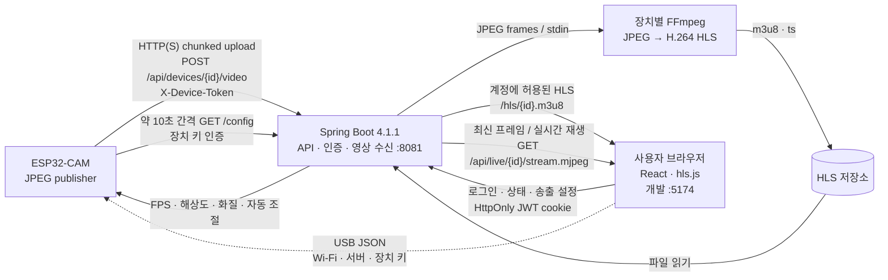
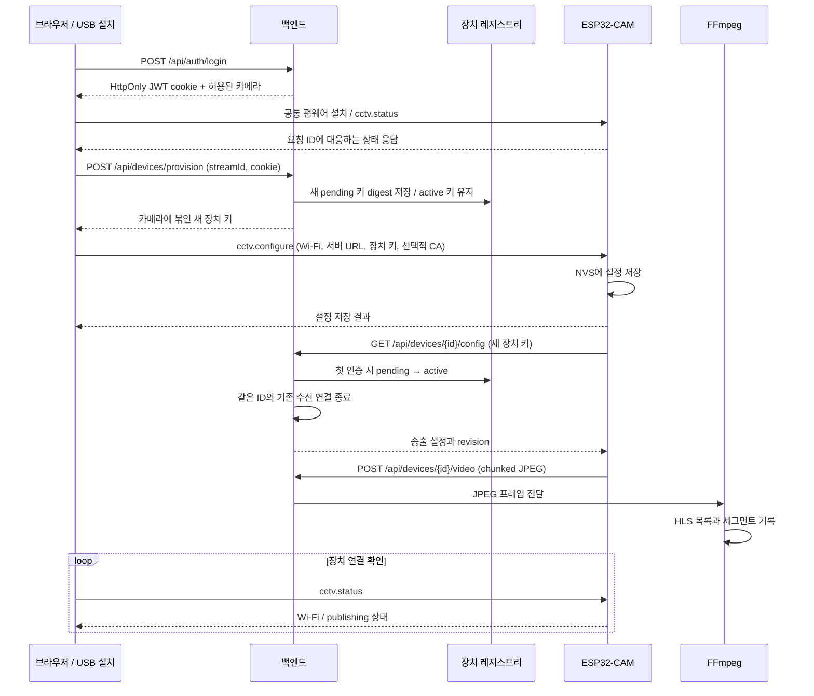
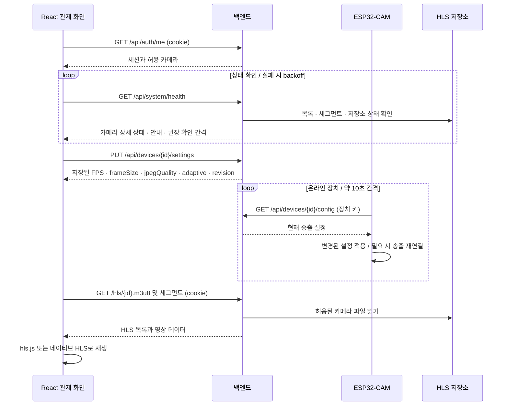
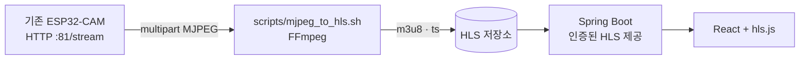

# CCTV_Streaming 시스템 아키텍처

## 현재 기본 구성: 카메라에서 서버로 push

카메라가 서버의 HTTP(S) 영상 수신 API에 연결하고 JPEG 프레임을 전송합니다. 백엔드는 최대 2MiB의 JPEG 프레임을 검사하고, 카메라별 최신 프레임 하나를 인증된 브라우저에 multipart JPEG로 즉시 전달합니다. 느린 시청자는 오래된 프레임을 건너뜁니다. 동시에 FFmpeg가 기존 HLS 영상 목록과 세그먼트를 생성하며, 웹의 호환 재생에서 사용할 수 있습니다.

서버가 카메라의 사설 IP에 접속할 수 없어도 카메라에서 서버 주소로 연결할 수 있으면 사용할 수 있습니다. 로컬 개발은 서버의 LAN 주소를 사용하며, 다른 네트워크의 카메라는 같은 백엔드로 연결되는 공개 HTTPS 주소를 사용합니다.

## 설치와 인증 흐름

키 발급만으로 기존 카메라가 중단되지 않습니다. 새 장치가 실제 서버 인증을 해야 기존 연결을 교체합니다. 따라서 USB 설정 저장 실패 시 이전 active 키를 유지할 수 있습니다. pending 키는 카메라 ID당 하나이며 재발급 시 이전 pending만 교체합니다. 기본 만료는 없고 `DEVICE_PENDING_TOKEN_TTL_SECONDS`로 양의 만료 시간을 지정할 수 있습니다.

장치 수신과 `/config`는 `X-Device-Token`으로 인증하며 브라우저의 로그인 쿠키를 사용하지 않습니다. 브라우저의 카메라 조회·키 발급·송출 설정·HLS 접근에는 로그인 쿠키와 계정의 카메라 권한이 필요합니다. 서버는 plaintext 장치 키 대신 SHA-256 digest를 레지스트리에 보관합니다.

## 관제와 송출 설정

웹 저장 성공은 서버에 설정이 저장된 결과입니다. 오프라인 카메라는 다시 서버에 연결해야 이를 적용할 수 있습니다. FPS는 목표값이며 실제 캡처 속도는 하드웨어와 네트워크 상태에 영향을 받습니다. 설정은 단일 영상의 원본 송출을 변경하며 시청자마다 선택하는 다중 ABR 화질을 만들지 않습니다.

## 구성 요소와 데이터 보존

| 구성 요소 | 역할과 보존 데이터 |
| --- | --- |
| `apps/frontend` | React 19 관제·로그인·상태 필터·HLS 재생·USB 설치·송출 설정. API query cache는 계정 종료 시 정리 |
| `apps/frontend/src/features/device` | Web Serial 연결, 줄 단위 요청/응답, 펌웨어 다운로드와 설치. Wi-Fi 자격증명을 USB로 직접 전달 |
| `apps/backend` | Spring Boot 4.1.1, Java 17. JWT cookie 인증, 카메라별 권한, 장치 키 인증, 상태 조회, FFmpeg 수신 세션과 HLS 제공 |
| `DeviceTokenRegistry` | 카메라별 active/pending 키 digest, 송출 설정과 revision. 파일에 저장하여 백엔드 재시작 후 유지 |
| `DeviceIngestService` | 장치별 JPEG 업로드를 FFmpeg stdin으로 전달. 동시 수신과 프레임 크기 제한, 연결 종료 시 프로세스 정리 |
| HLS 저장소 | 기본 `apps/backend/hls`. 장치별 `{id}.m3u8`와 `{id}_*.ts`. 재생은 인증과 카메라 권한을 검사 |
| `apps/cctv/device` | AI Thinker ESP32-CAM 펌웨어. Wi-Fi·서버 주소·연결 키·선택적 CA를 NVS에 저장하고 JPEG를 서버로 전송 |

`./scripts/build_firmware.sh`는 개인 `wifi_secrets.h` 자격증명을 포함하지 않는 공통 이미지를 생성합니다. 브라우저는 manifest에 지정된 bootloader·partition table·boot app·application 네 부분을 각 flash offset에 기록하여 NVS 영역을 보존합니다. 배포에는 manifest와 각 firmware part를 함께 포함해야 합니다.

TLS 연결은 기본 인증서 목록 또는 설치 시 지정한 서버 CA로 서버 인증서를 검증합니다. 브라우저는 Wi-Fi 비밀번호를 백엔드나 브라우저 저장소에 저장하지 않습니다. USB 설정 응답은 `requestId`, `ok`, Wi-Fi 및 송출 상태를 사용하며 부트 로그와 구분합니다.

## 주소, 포트와 배포

| 경로 / 포트 | 용도 |
| --- | --- |
| `localhost:5174` | Vite 개발 웹 화면. USB 설치는 Chrome/Edge의 localhost 또는 HTTPS 환경 필요 |
| `:8081` | 백엔드 API와 인증된 HLS |
| `/api/auth/*` | 로그인·복원·로그아웃 |
| `/api/system/health` | 스트림 상세와 저장소를 함께 확인하는 관제 상태 조회 |
| `/api/devices/server-info` | 카메라에 입력할 서버 주소 안내 |
| `/api/devices/provision` | 계정에 허용된 카메라의 pending 장치 키 발급 |
| `/api/devices/{id}/settings` | 브라우저에서 송출 설정 조회·저장 |
| `/api/devices/{id}/config` | 장치 키로 송출 설정 조회 및 최초 키 활성화 |
| `/api/devices/{id}/video` | `application/octet-stream`의 HTTP chunked JPEG 수신 |
| `/hls/*` | 카메라별 영상 목록과 세그먼트 |
| `/firmware/*` | 프론트 정적 파일로 제공하는 공통 펌웨어 설치 파일 |
| 장치 `:81/stream` | 기존 LAN pull에서 사용하는 선택적 MJPEG 주소 |

생산 환경은 정적 프론트와 `/firmware/*`, 백엔드 `/api/*`·`/hls/*`를 HTTPS reverse proxy 뒤에 제공합니다. 카메라에는 공개 서버 주소를 입력하고 필요하면 `DEVICE_INGEST_PUBLIC_BASE_URL`로 이를 고정합니다. Vite의 `/api`·`/hls` 개발 프록시는 정적 build에 포함되지 않습니다.

긴 `/video` 요청은 request buffering을 끄고 chunked 입력을 즉시 전달해야 합니다. Nginx에는 HTTP/1.1, `proxy_request_buffering off`, 충분한 read/send timeout과 업로드 전체 크기 제한 조정이 필요합니다. [프로젝트 README의 예시](../../README.md#원격-서버와-reverse-proxy)를 참고하세요. 백엔드 기본 연결 timeout은 30초, 동시 수신 한도는 8개, JPEG 한 프레임 한도는 2MiB이며 환경 변수로 조정합니다.

## 선택적 레거시 LAN pull

이 방식은 서버가 카메라의 LAN 주소에 직접 접근할 수 있을 때 사용합니다. `--with-converter` 또는 `scripts/mjpeg_to_hls.sh`로 실행하며 장치가 서버에 먼저 연결하는 push와 구분합니다. **같은 카메라 ID로 pull converter와 push 수신을 동시에 실행하지 마세요.** 두 프로세스가 같은 HLS 파일을 기록할 수 있습니다.

기존 [SVG 그림](./system_architecture.svg)과 [draw.io 편집 파일](./system_architecture.drawio)은 이 LAN pull 흐름의 레거시 참고 자료입니다. 현재 기본 원격 push 구성은 문서 첫 Mermaid 그림을 기준으로 합니다.

## 운영 시 구분할 상태

- 카메라의 Wi-Fi 연결과 서버 송출은 별개입니다. USB에서 Wi-Fi가 연결되었어도 서버 주소·TLS·장치 키가 맞아야 송출합니다.
- `publishing` 상태와 관제의 HLS `LIVE`는 별개입니다. 영상 조각을 모으는 초기 구간에는 송출 중이어도 재생 준비 상태일 수 있습니다.
- 상태 조회 실패 시 관제의 이전 수치가 최신임을 보장하지 않습니다. 화면은 지연 안내와 마지막 확인 결과임을 표시합니다.
- HLS 재생에는 수초의 지연이 있습니다. 플레이리스트 기준 지연 지표는 촬영부터 표시까지의 전체 지연을 측정하지 않습니다.
- 현재 RTSP 입력, WebRTC, 시청자별 다중 ABR HLS 화질은 구현되어 있지 않습니다.

실행 명령과 인증 환경 변수는 [프로젝트 README](../../README.md), endpoint의 요청/응답은 [API 계약](../api/API_CONTRACT.md), 상세 수신 한도와 운영 설정은 [백엔드 README](../../apps/backend/README.md)를 참고하세요.
